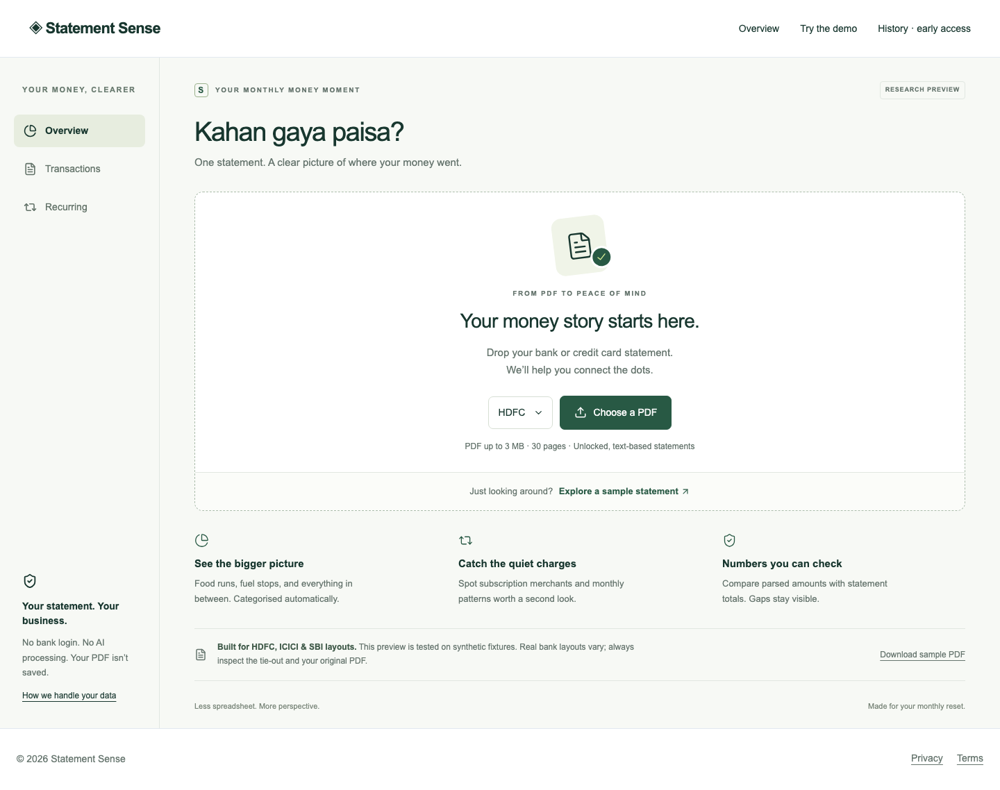
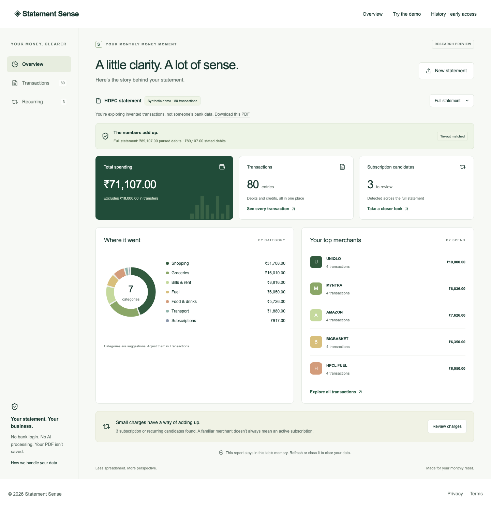
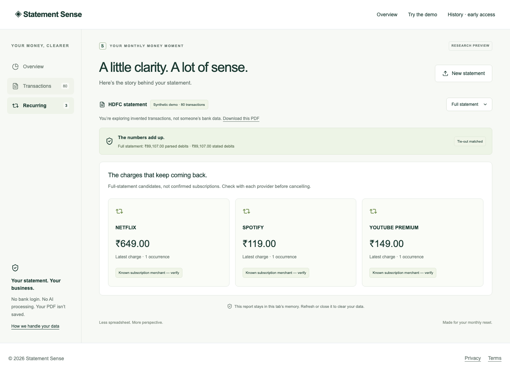
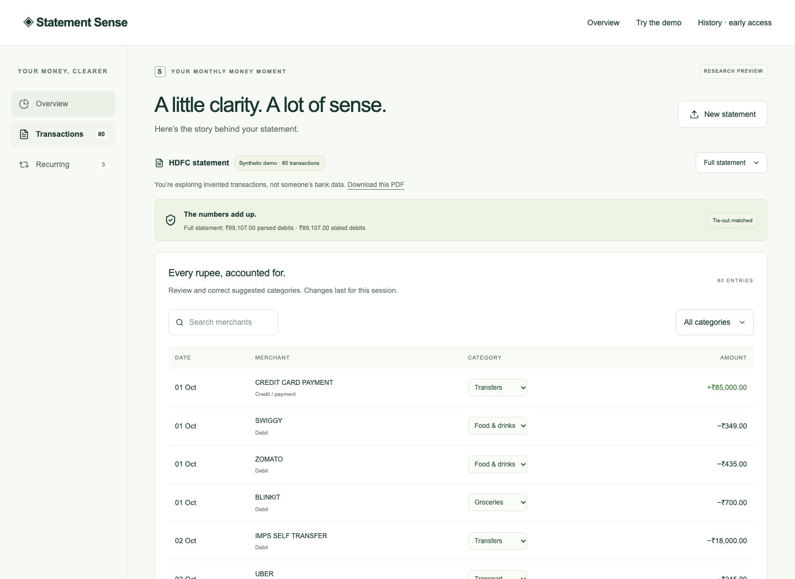
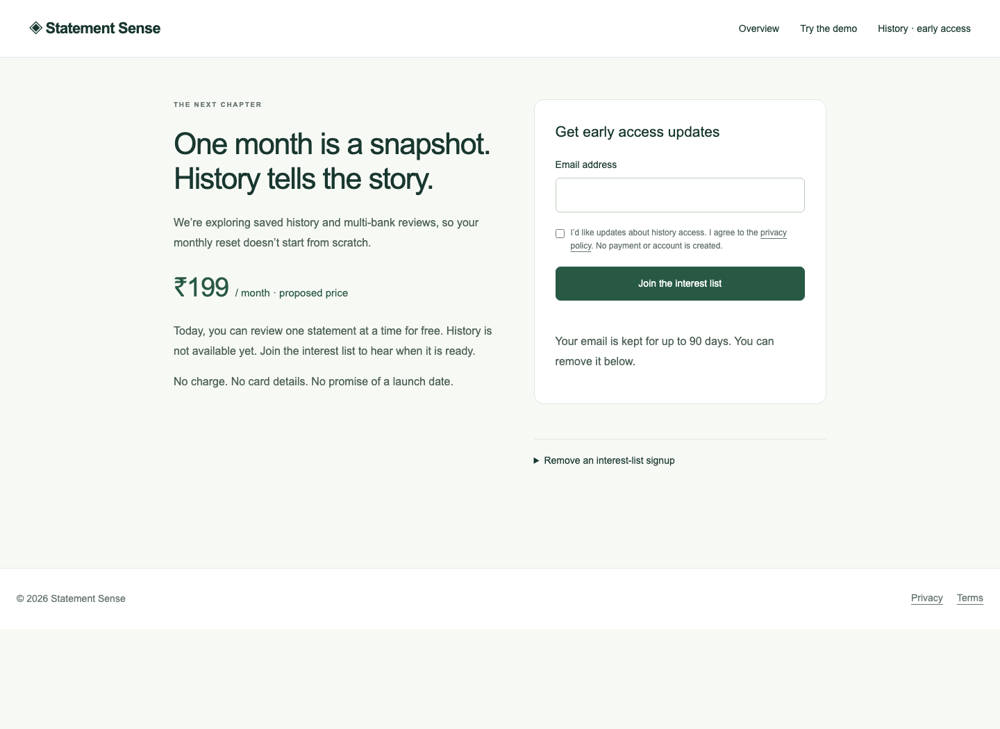
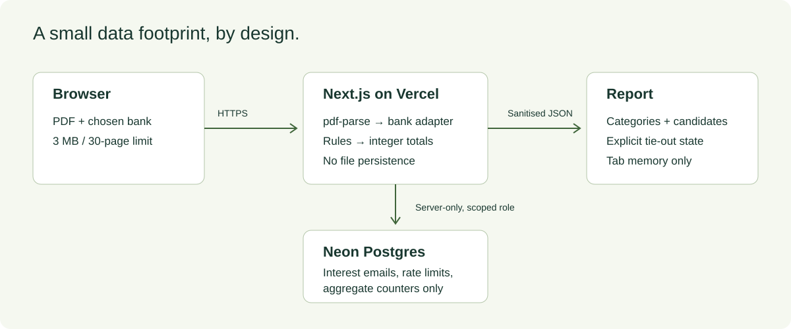
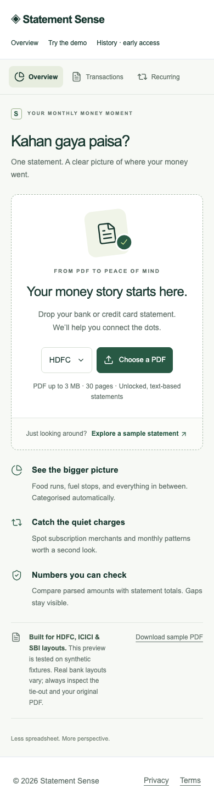
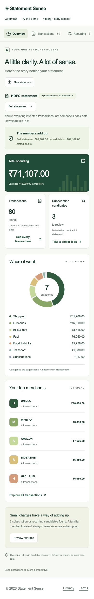
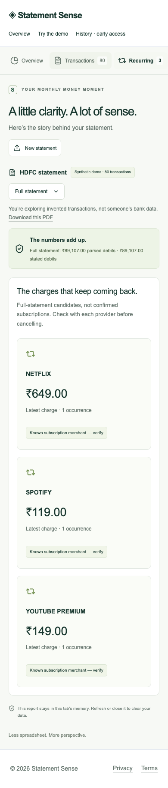
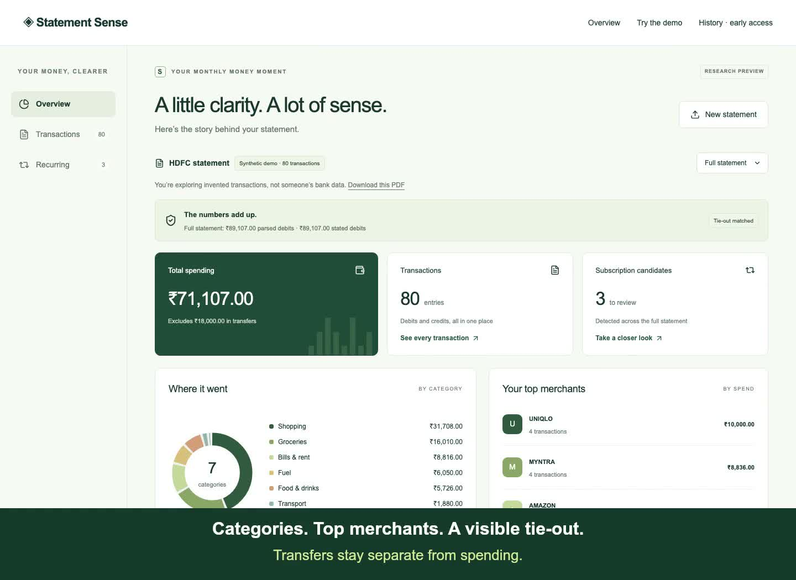

<p align="center"></p>
<p align="center">Your monthly “kahan gaya paisa?” answer, with numbers you can check.</p>
<p align="center"><a href="https://nextjs.org"></a> <a href="https://www.typescriptlang.org"></a> <a href="LICENSE"></a> <a href="package.json"></a> <a href="https://statement-sense-seven.vercel.app/demo"></a></p>

[Open the live synthetic demo](https://statement-sense-seven.vercel.app/demo). Public uploads and interest signup await authorization to configure the app’s production secrets. Both flows are implemented and tested locally.

## The problem

“Salary aayi thi. Kahan gaya paisa?” A familiar question, used here as product framing rather than a customer quote. For young Indian earners juggling cards and UPI payments, a bank PDF is a list of rows when what they need is an explanation.

## How we felt it

The workflow that motivated this build: download a statement, copy rows into a spreadsheet, recognise the same merchants again, and still wonder whether a missing row changed the answer. This is the design scenario behind Statement Sense, not a claim of founder interviews or measured customer demand. [Research and the validation plan](PLAN.md) record what is known and what remains untested.

## What we built

### Drop one statement

Choose HDFC, ICICI or SBI and upload an unlocked, text-based PDF. Limits are 3 MB, 30 pages and 2,000 parsed rows. Unsupported layouts get an error or explicit incomplete-result warning. The bank adapters are tested on synthetic layouts, not a broad corpus of bank-issued PDFs.



### See where the money went

A monthly filter, spending categories, and top merchants make the report inspectable. Amounts use integer paise. Transfers are excluded from spending, and credits are not silently treated as income or netted against purchases.



### Catch recurring candidates

Known subscription merchants are flagged for review. A monthly pattern requires dates 25–35 days apart and approximately equal amounts. Repeated coffee purchases do not become a subscription merely because they repeat.



### Inspect the rows and the tie-out

Search merchants, filter categories, and correct classifications in memory. Reconciliation compares explicit debit and credit totals; an amount-due field is never substituted for spending. Missing totals or unread dated rows prevent a matched result. A match establishes arithmetic consistency, not completeness of every possible undetected row or financial correctness.



### A truthful next step

One-statement review is free. Saved history and multi-bank review are proposed at ₹199/month; the interest list works, but those paid features and billing are not live.



## How it works



1. The browser uploads one PDF to a same-origin Next.js handler.
2. A shared Neon rate counter gates parsing; the upload stream has a byte cap.
3. pdf-parse extracts text and a bank adapter produces sanitised transaction rows.
4. Deterministic rules classify merchants, detect candidates, and reconcile integer totals.
5. Results live in tab memory; Neon stores interest signups and aggregate counters, never statements.

## Quickstart

Node 22.13+ and npm. The synthetic demo needs no account or database.

```sh
git clone https://github.com/SayedZahur786/statement-sense.git
cd statement-sense
npm ci
npm run dev
```

Open [localhost:3000/demo](http://localhost:3000/demo). For uploads and signup, supply a dedicated Neon DATABASE_URL, apply `migrations/001_initial.sql` with the owner role, then configure a restricted runtime role. See [deployment and operations](docs/deploy.md). Database failure closes upload access; it does not silently switch to an unsafe in-process limit.

Validation: `npm test`, `npm run lint`, `npm run build`, `npm run test:e2e`. Browser tests need a configured database and Chromium (`npx playwright install chromium`). `npm run build && npm run shots` starts the production build through Playwright and regenerates desktop/mobile PNGs of every main route. [Security evidence](docs/security-audit.md) distinguishes verified checks from launch limitations.

## Screenshots

<p>  </p>

All screenshots are real browser captures of this app. All financial figures shown are synthetic. The reusable capture script is [shots.spec.ts](tests/shots.spec.ts).

## Demo video

[](docs/demo.mp4)

[Play or download the MP4](docs/demo.mp4). The walkthrough includes local speech synthesis and large burned-in captions. It uses the [storyline](docs/demo-story.md), [real-browser recording](tests/demo.spec.ts), and [render script](scripts/render-demo.mjs). The source narration is committed; regenerating speech uses the macOS Samantha voice and FFmpeg. The video demonstrates synthetic data, not real bank compatibility.

## Why this is interesting

- **A tie-out can say “unverified”.** Missing totals and unparsed dated rows stay visible. This is less convenient than always showing a green result, but avoids turning uncertainty into confidence.
- **No financial history by default.** PDFs and rows never enter Postgres. The trade-off is that refresh loses a report and recurrence across separate uploads is unavailable.
- **Global limits, minimal identity.** Atomic Postgres counters work across server instances without trusting spoofable IP headers. The trade-off is that one busy user can consume the shared queue; availability under abuse remains a limitation.

This is a research preview. Broad real-statement compatibility, paid history and customer outcomes are not established. Read [the launch checklist](LAUNCH.md) before promoting it.
